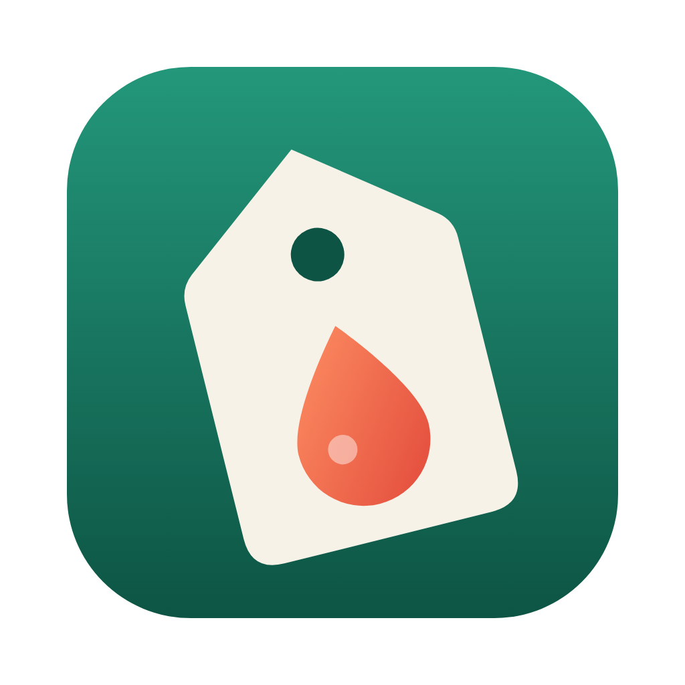
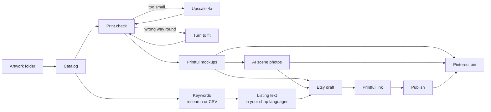

<p align="center">
  
</p>

<h1 align="center">POD Pipeline</h1>

<p align="center">
  A desktop app that turns a folder of artwork into Printful products and Etsy listings,
  then schedules the Pinterest pins that point to them.
</p>

<p align="center">
  macOS · Windows · Linux &nbsp;|&nbsp; English · Türkçe · Deutsch &nbsp;|&nbsp; MIT licensed
</p>

---

Selling print-on-demand on Etsy means doing the same steps for every design. You check that
the art prints sharp on the product, render mockups, look up what buyers search for, write a
title, a description and 13 tags, translate them, set prices and shipping, create the listing,
link each variant to Printful, and then promote it. POD Pipeline does those steps for you, one
design or a hundred at a time, and keeps each result for you to read and change before anything
goes public.

Everything runs on your computer. Your catalog, artwork and settings stay in a local folder, and
your keys are encrypted with the system keychain. The app never publishes on Etsy or Pinterest
without you asking it to, and it never spends money on an AI service unless you start that work
in the window.

## How a design moves through the app



Each box is a step on the design page. **Prepare listings** runs them for many designs in a row.

## What it does

### Imports your artwork as a catalog

Point the app at a folder where each concept has a numbered folder and each file is named after
the product it is for (`Mug.png`, `Blanket.png`, `Phone Case.png`). The file names may be English,
Turkish or German. Every design gets a readable code such as `01-mug`, and importing the folder
again only adds what changed. Older versions of a design stay as its revision history. One phone
case file makes both an iPhone case and a Samsung case, each with its own listing.

### Checks how each design prints

For every variant of the Printful product, the print check shows where the design lands on the
print area, its effective DPI and how much gets cut off when it fills the area. Clothing is
checked by colour and size, on the front or the back. A design that would print blurry is marked
before you spend anything on it.

### Upscales artwork that is too small

A 60″×80″ blanket needs a far larger image than a mug. **Upscale 4×** enlarges the artwork on your
own graphics card with [Real-ESRGAN](https://github.com/xinntao/Real-ESRGAN): 2560 × 3200 becomes
10240 × 12800. There is a model for drawn artwork and one for photos. The result is scaled back
down to what the largest size you sell needs (9600 × 12000 for a 60″×80″ blanket at 150 DPI) and
keeps the colour profile of the original. Nothing is uploaded, and the file you imported is kept
as the previous revision.

### Turns artwork that faces the wrong way

Portrait artwork on a print area Printful lists as landscape loses its top and bottom. Where
Printful also makes the product the other way up, as with the throw blanket, the app prints the
artwork upright on the turned area and nothing changes on your side. Where it does not,
**Turn to fit** rotates the artwork a quarter and stores it as a new revision. Your checking AI
looks at the artwork first, picks the direction that keeps it upright once the product is turned,
and can also say it is better left as it is.

### Renders mockups and scene photos

Printful renders product photos with your design on them. On top of those, an image AI (Gemini
or OpenAI) can place a photo in a setting you describe, such as a kitchen table in autumn light.
You can set the shot, light, season and props, or let the text AI read the style of a photo you
like and fill those settings in for you. The text AI then compares each scene with the original
photo and lists anything that changed in the print. A scene can go on a listing or a pin only
after you tick **I checked the print**.

### Collects keywords

Import a keyword CSV exported from eRank or Marmalead and the app keeps it with its figures exactly
as the file gives them. Etsy publishes no search volumes, so the app does not invent any.

The **Research** tab can also look at Etsy the way a buyer does: it searches in a hidden browser
window without signing in, in the United States, the United Kingdom or Germany, and counts the
phrases at least two shops use in their titles, which of them Etsy suggests while you type,
which ones name a trademark, the price range, ads, Star Sellers and badges. It runs only when you
start it, and batch runs never use it; they use your saved research and imported lists. If Etsy
asks you to prove you are a person, the window opens and you answer it yourself; the app does not
solve captchas.

Use it with care. Etsy's terms forbid automated access to its site, including scraping. The
search runs signed out, but from your computer and your internet connection, so Etsy may block
your IP address or take action against your Etsy account.

### Writes the listing text in your shop's languages

The text AI drafts the title, description and 13 tags from your notes and the words research
found, then translates them into the other languages of your shop (up to ten). Several checks
run on the result:

- The text states only the product facts you set under **Settings, Product facts** (material,
  care, size) and does not invent others.
- Words that name a trademark are pointed out.
- Phrases that read as machine-written are marked, with word lists for English, German, French,
  Spanish, Italian, Dutch and Portuguese, and are sent back once to be rewritten.
- An iPhone case listing never names Samsung, and a Samsung listing never names the iPhone, in
  any language.
- If you make your designs with AI tools, or a listing shows AI scene photos, a short note in the
  listing's language says so at the end of the description, as Etsy's Creativity Standards ask.

You can edit everything before the draft is created.

### Creates Etsy drafts and links them to Printful

The app creates each listing as an unpublished draft with the variants, prices, shipping profile
and up to ten photos, and gives every variant the SKU `PF-<Printful variant id>`. Drafts are free
and hidden. Photos with a transparent background are laid on white first, since Etsy shows
transparency as black, and **Update photos on Etsy** swaps a draft's photos for newer mockups.
With Printful store sync on, **Link to Printful** then tells Printful which product and print
file each variant is, using the placement from the print check. **What Etsy and Printful have
now** reads back the photos the listing shows on Etsy and Printful's pictures of the linked print
file, so you see what actually went out rather than what the app sent. **Publish** asks first,
since the listing becomes public and Etsy charges its listing fee.

The app is careful about duplicates. It marks a design before asking Etsy for a draft and clears
the mark only once the listing is saved. If a draft might exist on Etsy without the app knowing,
for instance because the connection dropped halfway, it makes no new draft for that design until
you have checked your Etsy drafts and said so.

### Prepares many listings in one run

Tick designs on the **Designs** page (or every design a filter matches) and choose **Prepare
listings**. Pick the steps, and the app first counts what it would do and what that costs:
print checks and Printful mockups are free, text requests bill your AI key, drafts are free until
you publish. The keyword step takes the saved research and imported lists that match each design's
concept and product. The run then works through one design and one step at a time
in the background. Progress is saved after every step, so a run interrupted by closing the app
can be resumed, and **Retry failed** keeps the text you already paid for. When an AI service says
it is busy, the run waits as long as the service asks (within limits) instead of failing the
design. Prices, sizes and shipping profiles per product come from **Settings**: a blanket can sell
50″×60″ at one price and 60″×80″ at another in the same listing.

### Plans Pinterest pins

Pick a photo, a headline to print on it, a title, a description, a board and a time. The app lays
the photo out as a 1000 × 1500 pin, publishes it at that time while the app is open, and links it
to the Etsy listing once that is live. Scene photos are labelled as AI-modified on Pinterest.

### Works with your AI assistant

The app ships an MCP server, so Claude Desktop, Claude Code or another MCP client can browse your
catalog, import from folders you approved, run print checks, render Printful mockups, research
Etsy, create drafts, link Printful and propose pins. Some actions stay in the window on purpose:
publishing on Etsy, publishing or approving pins, starting a batch run, upscaling, and anything
billed to your AI keys.

## Products

| Product      | Printful product                     |
| ------------ | ------------------------------------ |
| iPhone case  | Tough Case for iPhone (601)          |
| Samsung case | Tough Case for Samsung (686)         |
| Mug          | White Glossy Mug (19)                |
| Blanket      | Throw Blanket (395)                  |
| T-shirt      | Bella + Canvas 3001 (71)             |
| Sweatshirt   | Gildan 18000 (145)                   |
| Hoodie       | Gildan 18500 (146)                   |
| Poster       | Enhanced Matte Paper Poster (1)      |
| Canvas       | Canvas (3)                           |
| Tote bag     | Econscious EC8000 Eco Tote Bag (367) |
| Sticker      | Kiss-Cut Stickers (358)              |

## Install

Download the installer for your system from the [releases page](../../releases): a DMG for macOS
(Apple silicon or Intel), an installer for Windows, or an AppImage for Linux.

Releases without a signing certificate are not trusted by the system at first.

- On macOS, open the app once, then go to **System Settings, Privacy & Security** and choose
  **Open Anyway**.
- On Windows, choose **More info, Run anyway** in the SmartScreen warning.
- On Linux, make the AppImage executable. It needs `libfuse2`; on Ubuntu 24.04 and later, start
  it with `--no-sandbox` if it does not open. Keys are saved only when a keyring (GNOME Keyring
  or KWallet) is running.

## Getting started

1. Connect Printful and a file host under **Settings, Connections**.
2. Connect Etsy, and an AI service if you want listing text and scene photos.
3. Set a price, the sizes to sell and a shipping profile for each product under **Settings**.
4. Import your artwork folder from **Designs**.
5. Open a design and go through its steps, or tick several and choose **Prepare listings**.
6. Read the drafts, then publish the ones you like.

The sections below explain each connection.

## Preparing your artwork

```
Designs/
  01. Frost Garden/
    Mug.png
    Blanket.png
    Phone Case.png    (makes an iPhone case and a Samsung case)
  02. Lantern Harbor/
    Kupa.png          (Turkish and German product names work too)
  03 T-Shirt.png      (or name a file by concept number and product)
```

A leading label such as `01. Design - Frost Garden` is dropped from the concept name. A
`Samsung Case.png` next to a phone case file is used for the Samsung listing instead; turn off
**Settings, Samsung cases** to make only iPhone cases from phone case files.

## Connections

### Printful and a file host

Printful reads your design from a link, so the app needs both.

1. **Printful:** a private token from the Printful Developer Portal for a single store. The app
   calls Printful's API v1 and does not work with account-wide tokens.
2. **A file host**, one of:
   - **Dropbox:** create an app in the Dropbox App Console with "App folder" access and the
     `files.content.write` and `files.content.read` permissions. Enter its app key, allow access
     in the browser and paste the code back. Shared links expire after four hours.
   - **Cloudflare R2 or another S3-compatible store:** a bucket and an API token with read and
     write access to it. Links are presigned and expire after 15 minutes.

The design is uploaded only while Printful needs it and deleted right after. Uploads go to a
`pod-pipeline/` folder. If a deletion fails, the file stays there; on R2 or S3 a lifecycle rule
that deletes objects under `pod-pipeline/` after a day cleans up such leftovers. Print files over
100 MB are refused, which is the lowest limit Printful's help pages give.

### Etsy

1. Create an app on [etsy.com/developers](https://www.etsy.com/developers) and add
   `http://localhost:3003/oauth/redirect` as its callback URL. Etsy does not allow the word
   "Etsy" in an app's name. A new app has personal access, which is all this app needs: it works
   with your own shop only.
2. Enter its keystring and shared secret under **Settings, Connections** and sign in in the
   browser. The app asks for listing and shop access only.
3. In Etsy, add Printful as a production partner and create the shipping profiles you want to use.

Etsy rotates its sign-in tokens. If the app ever fails to save a new one, Settings asks you to
reconnect so that the next start does not find you signed out.

### AI services

You bring your own keys; each service bills your account for what it does. A key is checked with
the service, at no cost, before it is saved.

- **Text AI** writes and translates listing text, checks prints in scenes and describes photos:
  Claude (Anthropic), ChatGPT (OpenAI), DeepSeek, Kimi (Moonshot AI) or Gemini (Google). You pick
  a writing model and a checking model; the checking model has to read images. Kimi keys come
  from the international platform, not moonshot.cn.
- **Image AI** makes scene photos: Gemini or ChatGPT. Google needs billing turned on for Gemini
  images.

Each service lists its models with the recommended one preselected, and a newer model can be
entered by its ID. One Gemini or OpenAI key serves both text and images.

### Pinterest

1. Create an app on [developers.pinterest.com](https://developers.pinterest.com) and add
   `http://localhost:3004/oauth/redirect` as its redirect URI.
2. Enter its app ID and secret under **Settings, Connections** and sign in in the browser.

Pins are published while the app is open. A pin due while the app was closed goes out the next
time it starts. If the app closes while a pin is being sent, the pin is marked as possibly
published rather than sent twice.

### Your AI assistant

While the app is open it serves a local API on `127.0.0.1`, protected by a token in its data
folder. The bundled MCP server talks to that API, so the app has to be running when the assistant
uses it. The assistant starts the server by running the app with `--mcp-server`, which opens no
window; you do not need Node.js.

**Settings, AI assistant** shows the command for Claude Code and the JSON for Claude Desktop and
other MCP clients, with the paths for your computer, ready to copy. On macOS, move the app to
Applications first: started from elsewhere, macOS may run it from a temporary path.

Tools: `list_product_families`, `list_designs`, `get_design`, `list_import_folders`,
`preview_import`, `run_import`, `check_print`, `create_mockups`, `list_mockups`,
`get_shop_options`, `get_listing`, `create_etsy_draft`, `link_printful`, `refresh_listing`,
`get_listing_photos`, `replace_etsy_draft_photos`, `research_etsy`, `list_research`, `get_research`,
`list_pinterest_boards`, `list_pins`, `propose_pin` and `get_batch_status`.

An assistant can import only from folders you chose at least once in the import dialog, and from
folders inside them. `run_import` accepts only the fingerprint of a preview, so nothing is
imported that was not previewed first. Pins an assistant proposes wait for your approval.

## Privacy and safety

- All data stays on your computer. Set `POD_DATA_DIR` to keep it in a folder of your choice.
- Keys and sign-ins are encrypted with the system keychain and never leave the app's main
  process. The local API that assistants use cannot read or change them.
- Error messages and logs hide anything that looks like a key or token.
- Packaged builds turn off running as plain Node (`RunAsNode`), `NODE_OPTIONS` and inspector
  arguments and turn on asar integrity checks.
- Etsy's terms limit automated access to its site. Research is spaced at least 15 seconds per
  search and capped at 30 searches an hour, but use it sparingly and at your own risk.

See [SECURITY.md](SECURITY.md) for how to report a vulnerability.

## Development

You need Node.js 24 (see `.nvmrc`).

```sh
npm install
npm run fetch:upscaler                      # download the upscaling engine once (pinned SHA-256)
npm run dev --workspace @pod/desktop        # start the app with hot reload
npm run check                               # format, lint, dead code, types, license notices, tests
npm run test:coverage                       # unit tests with coverage thresholds
npm run test:e2e                            # build the app and run the end-to-end tests
npm run test:research-samples               # store the sample Etsy research reports again
npm run dist:dir --workspace @pod/desktop   # package the app for this computer, unpacked
npm run dist --workspace @pod/desktop       # make the installers for this system
```

Tests never call Printful, Etsy, Pinterest or any AI service. Unit tests use the in-memory ports
in `packages/core/src/testing` and stubbed `fetch`. The end-to-end tests in `apps/desktop/e2e`
start the real app against a local fake of Printful, Etsy, Pinterest and Dropbox, so importing,
print checks, mockups, drafts, pins, keyword imports, quitting mid-run and the window security
settings are all exercised through the interface. That fake can only be switched on in an
unpackaged build. `fetch:upscaler` downloads the Real-ESRGAN v0.2.5.0 release for your system
into `apps/desktop/resources/upscaler/`, which git ignores; packaging needs it too. On Linux the
engine needs the Vulkan loader (`libvulkan1`) and the OpenMP runtime (`libgomp1`).

Pushing a tag that matches the app version, such as `v0.1.0`, builds the installers on every
system and attaches them to a draft GitHub release. Signing uses these repository secrets when
they are set: `MAC_CSC_LINK` and `MAC_CSC_KEY_PASSWORD` (Developer ID certificate),
`APPLE_API_KEY` (the contents of the App Store Connect `.p8` key file), `APPLE_API_KEY_ID` and
`APPLE_API_ISSUER` (notarization), and `WIN_CSC_LINK` and `WIN_CSC_KEY_PASSWORD` (Windows).

See [CONTRIBUTING.md](CONTRIBUTING.md) before opening a pull request. Everyone taking part is
expected to follow the [Code of Conduct](CODE_OF_CONDUCT.md).

## Architecture

The code follows ports and adapters. Business rules live in `packages/core` and know nothing
about Electron, SQLite or the file system; the small pure rules the window needs too, such as
Etsy's listing limits and what each product family is, live in `packages/rules`. Each outside
service has its own adapter package, and the adapters are wired together only in
`apps/desktop/src/main/composition`. ESLint boundary rules keep it that way.

```
packages/
  core                 domain model, use cases and the ports they need
  rules                pure rules shared by the core and every client: family profiles, limits
  contracts            request validation and data shapes shared by every client
  adapter-sqlite       catalog storage on node:sqlite
  adapter-fs           folder scanning, hashing, image inspection, asset storage, scaling,
                       turning and flattening PNGs
  adapter-printful     Printful catalog, mockups and store sync
  adapter-etsy         Etsy sign-in, shop settings and listings, and reading its search pages
  adapter-pinterest    Pinterest sign-in, boards and pins
  adapter-file-hosts   short-lived links through Dropbox or S3-compatible storage
  adapter-realesrgan   the Real-ESRGAN upscaling engine as a child process
  adapter-ai           listing text, scene checks and scene styles from any JSON-answering model
  adapter-anthropic    Claude
  adapter-openai       ChatGPT, DeepSeek and Kimi, and OpenAI image models
  adapter-gemini       Gemini text and images
  adapter-http         shared HTTP plumbing: retries, timeouts, OAuth tokens, error classification,
                       HTTPS downloads
apps/
  desktop              Electron shell: composition root, IPC, local API, windows
  ui                   React interface (Radix Themes, TanStack Query, i18next)
  mcp                  MCP server for AI assistants
```

Inside the desktop app, `src/main/application` holds thin services over the core use cases,
grouped by feature, and `composition` only wires the adapters into them. The app's own
infrastructure sits beside them: `files`, `storage` and `assets` keep the data folder, the
settings and secrets files and the thumbnails, `sign-in` waits for a service's answer to a
browser sign-in, `lifecycle` closes everything on quit, `local-api` serves the MCP server,
`window` builds the sandboxed windows and `shared` holds small helpers every layer may use.

The interface in `apps/ui/src` is split into `features/<feature>` folders, with data access in
hooks next to the components and shared pieces in `shared/`.

Every storage adapter passes the same contract tests as the in-memory reference implementation in
`packages/core/src/testing`. Every request from the window, the local API or the MCP server is
validated with the schemas in `packages/contracts`.

### Known limits

- Thumbnails of PNGs above 40 million pixels are decoded in a worker thread; every other image is
  decoded in the main process. A utility process would isolate decoding further.
- Releases are unsigned until signing certificates are added to the repository secrets.

## Credits

The Printful integration was designed with reference to
[Purple-Horizons/printful-mcp](https://github.com/Purple-Horizons/printful-mcp) and
[RitikKadyan/printful-mcp-server](https://github.com/RitikKadyan/printful-mcp-server), both MIT
licensed. Upscaling runs [Real-ESRGAN](https://github.com/xinntao/Real-ESRGAN)'s ncnn Vulkan
program (MIT) with its models (BSD 3-Clause), shipped unchanged. See
[THIRD_PARTY_NOTICES.md](THIRD_PARTY_NOTICES.md), which also lists the licenses of the
packages bundled into the app.

## Trademarks

The term 'Etsy' is a trademark of Etsy, Inc. This application uses the Etsy API but is not
endorsed or certified by Etsy, Inc.

Printful and Pinterest are trademarks of their owners. This project is not affiliated with,
endorsed or sponsored by Printful, Pinterest, or any AI service it connects to.

## License

[MIT](LICENSE)
